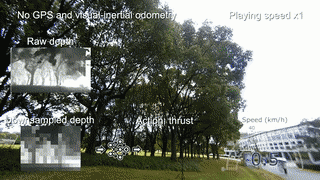

# Vision-based Agile Flight Training Code

## Overview

This repository contains the training code for our research on **Learning Vision-based Agile Flight via Differentiable Physics**. Accepted by [**Nature Machine Intelligence'25**](https://www.nature.com/articles/s42256-025-01048-0). 

[Project webpage](https://henryhuyu.github.io/DiffPhysDrone_Web/) is alive.

## Quick Demos
### Single Agent Flights
<table>
  <tr>
    <td></td>
    <td></td>
  </tr>
</table>

### Swarm Tasks
<table>
  <tr>
    <td></td>
    <td></td>
  </tr>
</table>


## Environment Setup
### Python Environment

The code is tested with the following environment:

- **PyTorch**: 2.2.2
- **Python**: 3.11
- **CUDA**: 11.8

The code should be compatible with other PyTorch and CUDA versions.

### Build CUDA Ops

To build the CUDA operations, run the following command:

```bash
pip install -e src
```

## 当前双 Profile 训练与 Newton Benchmark

本 checkout 已实现 IMPLEMENT_PLAN.md。完整运行命令、输入契约、场景配置和验证边界见 [IMPLEMENTATION.md](IMPLEMENTATION.md)。

~~~bash
python main_cuda.py --profile vanilla
python main_cuda.py --profile Newton-Modifed
~~~

默认每种 profile 训练 50,000 iterations；训练不读取 benchmark 地图。用户人工选定新版 checkpoint 后，通过 aerial_lab 的 scripts/competitor/newton/standard_test.py 运行固定测试任务。

## Legacy Training Aliases

To start the training process, use the following command:

```bash
# Legacy filename; now selects independent procedural vanilla environments
python main_cuda.py $(cat configs/multi_agent.args)
# Legacy filename; same vanilla profile
python main_cuda.py $(cat configs/single_agent.args)
```

## Upstream Historical Evaluation

The following upstream simulator instructions do not describe the new versioned Newton benchmark checkpoints. See IMPLEMENTATION.md for the current evaluation entry point.

You need to download the simulation validation code from the GitHub release page.
To evaluate the trained model in multi-agent settings, use the following command to launch the simulator:
```bash
cd <path to multi agent code supplementary>
./LinuxNoEditor/Blocks.sh -ResX=896 -ResY=504 -windowed -WinX=512 -WinY=304 -settings=$PWD/settings.json
```

## Citation
If using this repository, please cite our work
```
@article{zhang2025learning,
  title={Learning vision-based agile flight via differentiable physics},
  author={Zhang, Yuang and Hu, Yu and Song, Yunlong and Zou, Danping and Lin, Weiyao},
  journal={Nature Machine Intelligence},
  pages={1--13},
  year={2025},
  publisher={Nature Publishing Group}
}
```
Then, run the following command to evaluate the trained model:
```bash
python eval.py --resume <path to checkpoint> --target_speed 2.5
```
